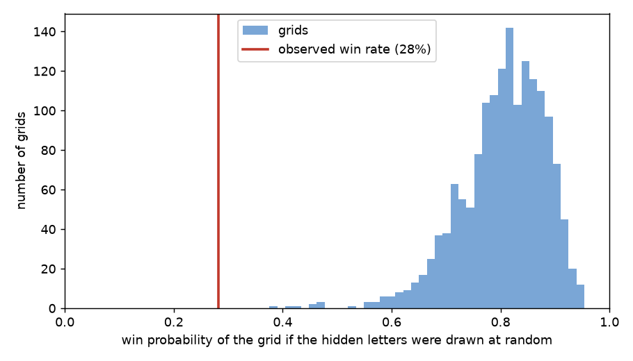
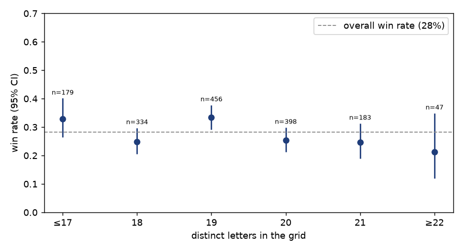
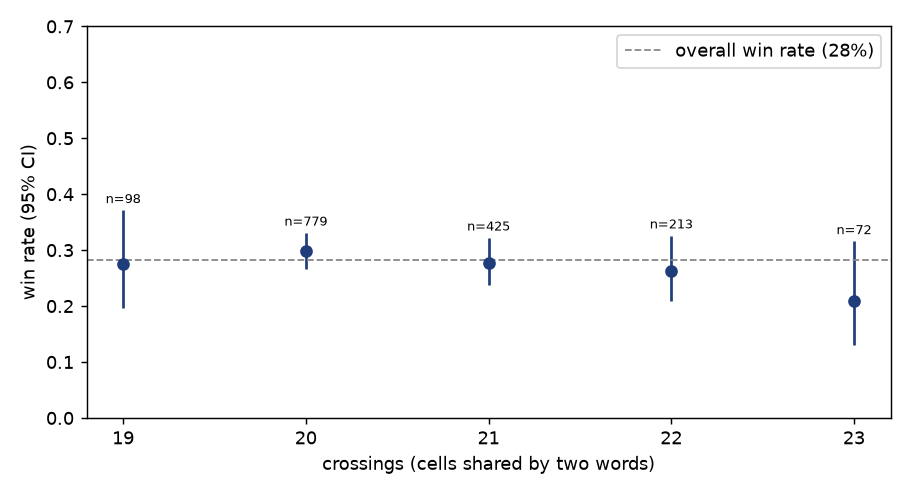
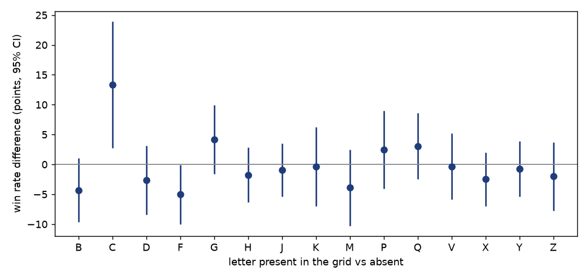

# Statistical analysis

## Question

Can the prize of a ticket be predicted from its visible grid? With $G$ the grid and $R$
the outcome, the game is statistically secure if $P(R = r \mid G = g) = P(R = r)$ for
every grid and every outcome, i.e. $I(G; R) = 0$ (see the [README](../README.md)).

## Data

The study was carried out on a variant of the crossword game of a national lottery,
using 1,597 tickets extracted from videos with the pipeline of this repository.
28.2 % of them win something (95 % CI 26.0 %–30.4 %).

## Results

### 1. Every prize can be won with every grid

For each grid, we listed every set of hidden letters allowed by the rules of the game
and counted the words each set completes. An outcome is possible on a grid if at least
one set of hidden letters produces it.

| Outcome | Grids where it is possible |
|---|---|
| Losing (0 or 1 word) | 1,597 / 1,597 |
| 2 words | 1,597 / 1,597 |
| 3 words | 1,597 / 1,597 |
| 4 words | 1,597 / 1,597 |
| 5 words | 1,597 / 1,597 |
| 6 words | 1,597 / 1,597 |
| 7 words | 1,597 / 1,597 |
| 8 words | 1,597 / 1,597 |
| 9 words (top prize) | 1,597 / 1,597 |

Every outcome is possible on every grid, so looking at a grid never rules out a prize.
This is the necessary condition stated in [secure_generation.md](secure_generation.md).

### 2. The hidden letters are not drawn at random

If the hidden letters were drawn at random, the grids would win 80.5 % of the time on
average, and none of them less than 37.6 %. The observed win rate is 28.2 %
(z = −54). The publisher therefore does not draw the letters at random: it chooses the
outcome first, then hidden letters that produce it. This is the scheme described in
[secure_generation.md](secure_generation.md), and with it the remaining question is
whether the outcome is chosen independently of the grid.

### 3. No feature of the grid predicts the outcome

If the outcome depended on the grid, grids with some visible property would win more
often than others.

#### Number of distinct letters

With few distinct letters in the grid, the hidden
letters cover a larger part of them, so words are easier to complete. The extreme
groups are merged (≤ 17 and ≥ 22 letters).

The win rate stays around 28 % whatever the number of distinct letters
(Spearman ρ = −0.04, p = 0.10).

#### Number of crossings

Crossing words share letters, so a grid with many crossings
has more words depending on the same letters.

No trend either (ρ = −0.03, p = 0.17). Grids with 18 or 24 crossings (10 grids in
total) are left out, as they are too few to give a meaningful rate.

#### Letters present in the grid

For each letter, the win rate of grids that contain it
was compared with the win rate of grids that do not (letters present in almost every
grid are left out).

Two letters reach p < 0.05 on their own (F and C), which is what chance alone gives
when testing 15 letters. After correcting for multiple testing (Benjamini-Hochberg),
none is significant (smallest q = 0.35).

#### All features together

Tested one by one, none of 37 features of the grid
(structure, letters present, probability of each outcome under random letters) is
linked to the outcome after correction for multiple testing. We then gave all of them
to two models trained to guess whether a ticket wins: a logistic regression, which
finds simple trends, and gradient boosting, which can also find combinations of
features.

Their score is the AUC: the probability that, given a winning and a losing ticket, the
model ranks the winning one higher. 0.5 means guessing at random, 1 means a perfect
guess. Each model is always scored on videos it was not trained on.

Because a model never scores exactly 0.5, even without any real link, we randomly
reassigned the outcomes among the tickets of each video (each video keeps its number of
winning tickets, but the link between a grid and its own outcome is broken) to measure
what chance alone gives, then trained and scored the models again, hundreds of times.
A real link would give an AUC higher than almost all of these runs.

| Model | AUC on the real outcomes | AUC on shuffled outcomes (95 % of runs below) | p |
|---|---|---|---|
| Logistic regression | 0.509 | 0.528 | 0.23 |
| Gradient boosting | 0.526 | 0.535 | 0.12 |

Both models do no better than on shuffled outcomes: knowing the whole grid does not
help to tell a winning ticket from a losing one.

## Limitations

- The results depend on where the videos come from. If they are mostly published by
  people who show their wins, the data is biased towards winning tickets.
- Only one variant of the game was studied.
- Finding no link does not prove that there is none: a small leak could go undetected
  with this amount of data.

## Conclusion

On 1,597 tickets, nothing in the visible grid predicts the prize. The hidden letters
are most likely chosen to produce a predefined outcome, every prize remains possible
with every grid, and no feature of the grid, alone or combined, tells a winning ticket
from a losing one. A possible way of generating tickets, based on these observations,
is described in [secure_generation.md](secure_generation.md).
