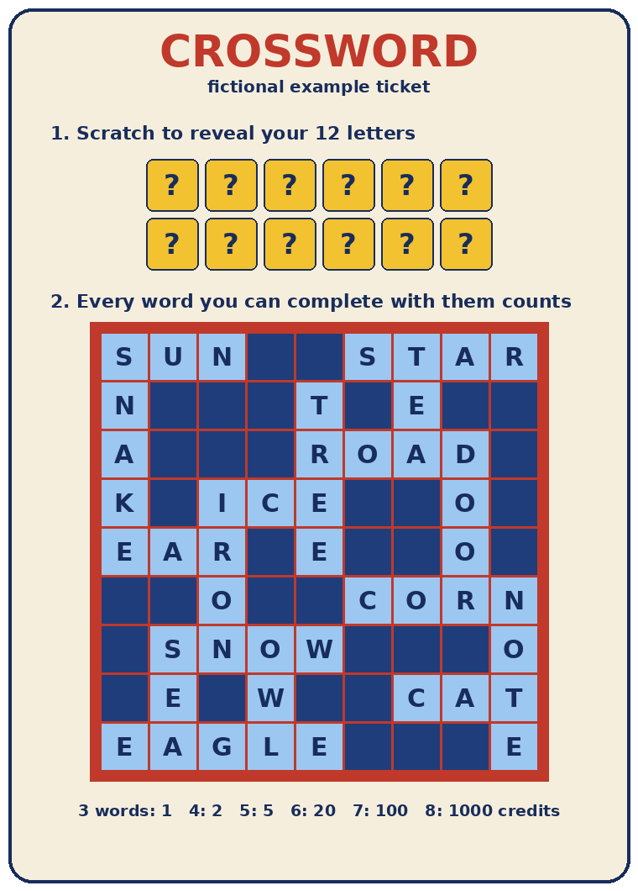
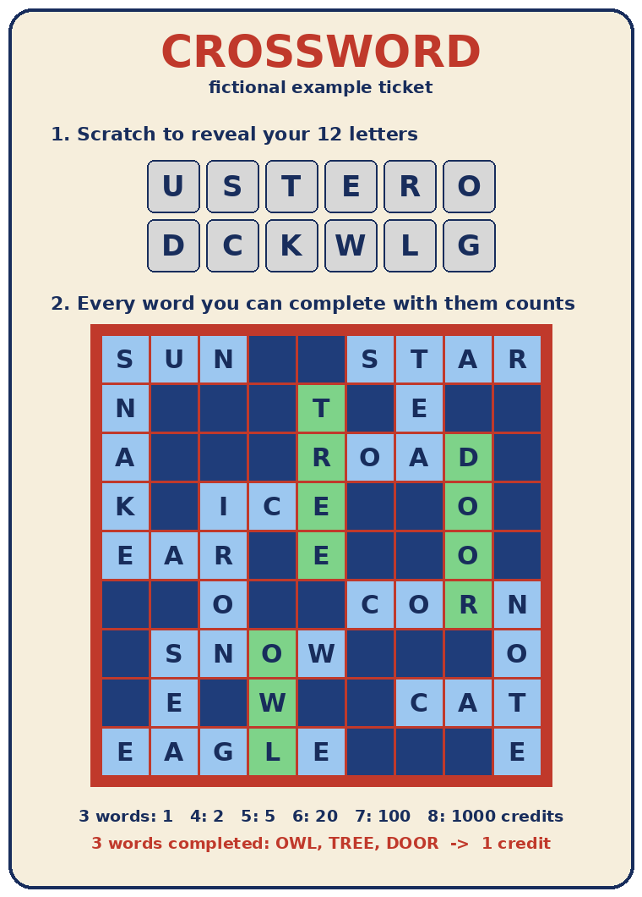

# The crossword scratch game

A crossword ticket has two parts:

- a grid of words, printed on the ticket and visible before scratching. It looks like
  a small crossword, but the words are already written in;
- a panel of hidden letters (12 here), under a scratch coating.

The player scratches the panel to reveal the letters. A word of the grid is completed
when all its letters are among the revealed ones, and the prize only depends on how
many words are completed.

| Before scratching | After scratching |
|---|---|
|  |  |

In this example the revealed letters are `U S T E R O D C K W L G`. They are enough
to write OWL, TREE and DOOR, but no other word of the grid: for instance ROAD misses
an A and NOTE misses an N. Three completed words win 1 credit.

The ticket, its rules and its payout are made up. They match the example game
description in [`configs/games/example_crossword_9x9.yaml`](../configs/games/example_crossword_9x9.yaml).

## Why this game is interesting

On most scratch tickets, nothing is visible before scratching. Here the grid is,
and it is different on every ticket. Since the prize depends on both the grid and
the hidden letters, the visible grid could tell something about the outcome. This
project measures whether it does.
