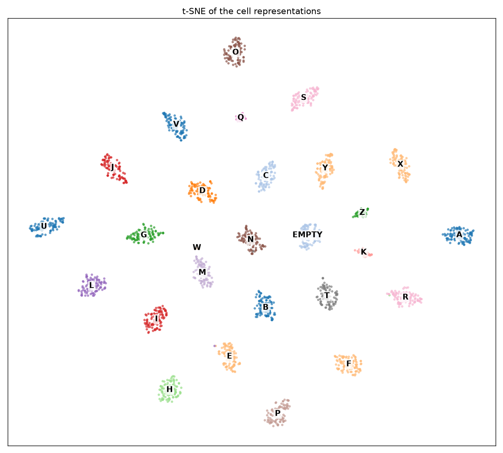
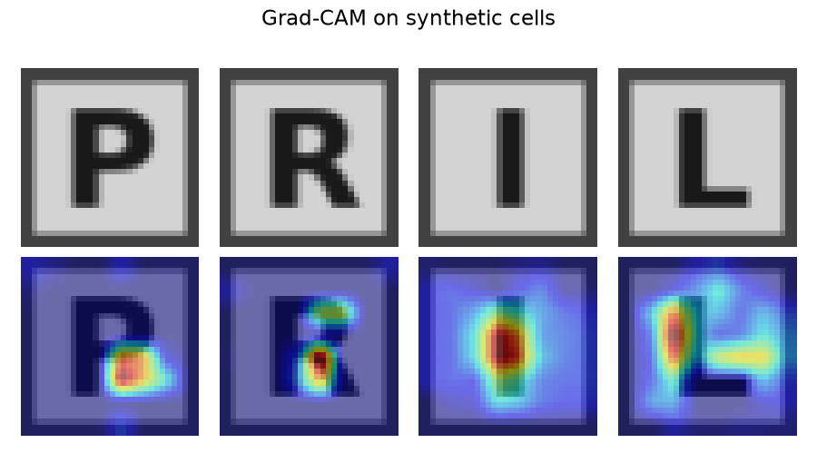

# Models

The weights are not in the repository. The game config says where they are and gives
their class names.

## Detector (`detector_obb.pt`)

YOLOv8n-OBB with two classes, draw panel and grid.

368 frames taken from gameplay videos were annotated (one oriented box per panel and
per grid) and split into 120 train, 150 validation and 98 test images.
The model was fine-tuned from the pretrained `yolov8n-obb.pt` for 25 epochs at 640 px
on CPU, with the default Ultralytics augmentations.

On the test images: mAP50 0.973, mAP50-95 0.957 (panel 0.974, grid 0.939).
Retraining with `train_detector` gives mAP50 0.972 and mAP50-95 0.947.

## Cell classifier (`cells.pth`)

A small CNN on 32x32 grayscale cells: three conv / batch norm / max-pool blocks, then
a 256-unit layer with dropout. It outputs a letter or an empty class for black cells.

Training data: 45,517 grid cells sorted into 27 folders. The grids were first read by
a language model, only letters belonging to a dictionary word were kept, and the
folders were then checked by hand.

Training: classes sampled evenly, small rotations and brightness/contrast changes,
Adam with the learning rate halved on plateaus, early stopping. 99.88 % accuracy on
the 20 % of images held out.

The 256 units before the last layer separate the classes well, and similar letters
end up close to each other (M and W, D and O):

Grad-CAM shows where the network looks to decide, here on letters drawn with a font.
A P is told apart from an R by the empty space where the R has its leg, and an L from
an I by its foot:

